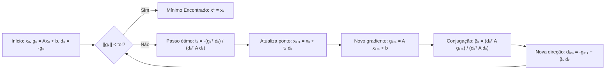

# 📐 Método dos Gradientes Conjugados — Otimização Quadrática (TCC)

[](https://colab.research.google.com/drive/1jpM90kuKxQ6HxFstiut75V1-EG-yoNHj)


Implementação em Python do **Método dos Gradientes Conjugados** para minimização irrestrita de funções quadráticas estritamente convexas.

> 💡 **Sobre este projeto:** Este repositório guarda o **meu primeiro código escrito em Python**, desenvolvido originalmente em 2021 para o meu **Trabalho de Conclusão de Curso (TCC)**, junto com uma **versão refatorada, limpa e didática** que preserva os arquivos históricos originais e mostra a evolução do código.

---

## 🎯 O Problema Matemático

O objetivo é encontrar o ponto de mínimo global $x^* \in \mathbb{R}^n$ de uma função quadrática convexa:

$$f(x) = \frac{1}{2} x^T A x + b^T x + c$$

onde:
* $A \in \mathbb{R}^{n \times n}$ é uma matriz **simétrica e definida positiva** ($A = A^T$ e $x^T A x > 0, \forall x \neq 0$);
* $b \in \mathbb{R}^n$ é um vetor;
* $c \in \mathbb{R}$ é uma constante escalar.

Enquanto o método do Gradiente Descendente clássico pode sofrer com trajetórias em "zigue-zague" em vales estreitos, o **Método dos Gradientes Conjugados** gera direções de busca $A$-ortogonais ($d_i^T A d_j = 0$ para $i \neq j$), garantindo a convergência exata em **no máximo $n$ iterações**.

### Fluxo do Algoritmo



---

## 🔄 Evolução do Código (Original do TCC vs. Versão Limpa)

O repositório mantém o código original intacto e inclui uma versão refatorada para estudo:

| Aspecto | Código Original (`Algoritomo_...`) | Versão Limpa (`gradiente_conjugado_limpo.py`) |
| :--- | :--- | :--- |
| **Multiplicação Matricial** | `np.dot(np.dot(d.T, A), d)` | Operador nativo `@`: `d @ A @ d` |
| **Critério de Parada** | Função `comparar(g)` com `for` e strings `"igual"` / `"Não igual"` | Norma euclidiana do gradiente: `np.linalg.norm(g) < tol` |
| **Eficiência por Iteração** | Recalculava `grad(x0)` e `A @ d` múltiplas vezes | Calcula `Ad = A @ d` uma única vez por iteração |
| **Estrutura** | Variáveis no escopo global | Funções puras com tipagem e histórico de trajetória |

---

## 📂 Estrutura do Repositório

```text
├── Gradiente_Conjugado_Limpo.ipynb               # Notebook refatorado, comentado e com gráfico de convergência
├── gradiente_conjugado_limpo.py                  # Script Python limpo, coeso e didático
├── Algoritomo_conjugados_quadraticos_teste.ipynb # Notebook original do TCC (compatível com Colab)
├── Algoritomo_conjugados_quadraticos_teste.py    # Primeiro script Python original (2021)
└── README.md                                     # Documentação do projeto
```

---

## 🚀 Como Executar

### 1. Direto no Navegador (Google Colab)
Clique no selo **Open in Colab** no topo desta página para abrir e rodar o notebook sem instalar nada.

### 2. Na sua Máquina Local
Clone o repositório e instale as dependências:

```bash
git clone https://github.com/Chico-Lima-Silva/algoritmo-conjugados-quadraticos-tcc.git
cd algoritmo-conjugados-quadraticos-tcc
pip install numpy matplotlib jupyter
```

Execute o script limpo no terminal:
```bash
python gradiente_conjugado_limpo.py
```

**Saída esperada:**
```text
=== EXEMPLO 1: Matriz Diagonal (Dados originais do TCC) ===
Iteração  0 | x = [10. 10.] | ||grad|| = 2.20e+02
Iteração  1 | x = [-0.533333 -0.2     ] | ||grad|| = 1.78e-15

Convergência atingida na iteração 1!
Ponto de mínimo encontrado: [-0.53333333 -0.2       ]
Solução exata (-A^-1 b)   : [-0.53333333 -0.2       ]
```

---

## 👤 Autor

**Francisco Lima (`Chico-Lima-Silva`)**
* Primeiro projeto em Python desenvolvido durante a graduação (TCC).
